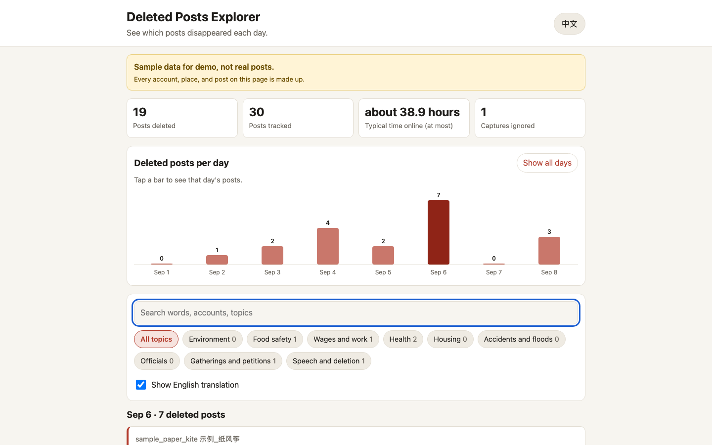

# Censorship Diff Explorer

Compare daily snapshots of social media posts and see, day by day, which posts disappeared.



> **The data in this repo is SAMPLE data for demo, not real posts.** Every account,
> place, and post was made up. Accounts start with `sample_` / `示例`, and places use
> invented names like 示例市 ("Sample City") and 虚构县 ("Fictional County").
> The page shows a yellow banner saying so, and every sample file carries
> `"sample": true` and `"notice": "Sample data for demo, not real posts"`.

## What it does

1. You collect **snapshots**: a list of the posts you can see, captured at a moment in time.
2. The engine compares snapshots in time order. **A post present in one capture and missing
   from the next one counts as deleted.**
3. The page shows a bar per day (Beijing time), and you tap a day to read what vanished:
   the original Chinese text, an optional English translation, the account, when it was
   posted, when it was last seen, when it was gone by, and how long it stayed up.

It also notices:

| Case | What the engine does |
|---|---|
| Deleted | Seen, then missing for good. Filed under the day of the first capture that missed it. |
| Edited | Same post id, new words. Not a deletion. Every version is kept and shown. |
| Re-posted | The same words come back under a new id after the first copy vanished. Both are linked. |
| Came back | Missing once, then visible again. Not a deletion (unless it vanishes again later). |
| Never seen | Posted and deleted between two captures. No snapshot holds it, so it cannot be reported. The page says so. |
| Broken capture | A capture that suddenly loses lots of posts, which then come right back, is a failed scrape, not mass deletion. It is ignored and explained on the page. |
| Account not crawled | If a snapshot lists the `accounts` it covered, posts from other accounts are not judged in that capture. |

## How to run it

Needs Node 22 or newer. No packages to install.

```bash
# Open the page: just double-click web/index.html (works straight from disk), or:
open web/index.html

# Rebuild the sample snapshots and the page data
npm run sample
npm run build

# Run all tests (engine, command line, and real headless browser at desktop + phone size)
npm test
```

The browser tests drive a headless Chrome directly over the DevTools protocol (no browser
library to install). Set `CHROME_PATH` to your Chrome or Chromium binary (see `.env.example`).
Without it they look for a Playwright-cached `chromium_headless_shell` in the usual cache
folder; if no browser is found, the browser tests are skipped locally. CI sets `CHROME_PATH`
and fails if any test is skipped. Screenshots land in `test-output/` (git-ignored).

Tests never touch the network: they use the sample snapshots in `data/sample/`.

## For agents and scripts (command line)

```bash
node cli/diff.mjs <folder-of-snapshots> --topics data/topics.json            # full JSON to stdout
node cli/diff.mjs <folder> --summary                                         # one line per day
node cli/diff.mjs <folder> --out result.json --js web/data/diff.js           # feed the page
node cli/diff.mjs <folder> --tz-offset 0 --max-drop 1                        # UTC days, guard off
```

Exit codes: `0` ok, `1` bad data (the message names the file), `2` bad options.
The web page and the command line call the same function (`src/engine.js`), so they
always agree. The page can also load your own snapshot files and run the diff in the
browser; nothing is uploaded.

### Snapshot format

One JSON file per capture:

```json
{
  "captured_at": "2026-09-01T09:00:00+08:00",
  "platform": "weibo",
  "accounts": ["optional list of accounts this capture covered"],
  "posts": [
    { "id": "4890...", "account": "name", "posted_at": "2026-09-01T08:15:00+08:00",
      "text": "原文", "gloss": "optional English translation" }
  ]
}
```

Every time **must** include a time zone (`+08:00` or `Z`). Times without one are refused,
because guessing the zone would put deletions on the wrong day.

Settings (all optional, passed as the second argument to `diffSnapshots` or as CLI flags):
`tzOffsetMinutes` (default 480, Beijing), `maxDropRatio` (0.5), `minPostsForDropCheck` (5),
`minReturnRatio` (0.25), `lexicon` (the topic keyword list).

## Standing on others' work (research)

This method is not new. These projects did it for real, at scale:

| Project | What it does | What we borrowed |
|---|---|---|
| [Weiboscope](https://jmsc.hku.hk/2016/03/weiboscope/) (University of Hong Kong, JMSC) | Tracks timelines of chosen Weibo accounts since 2011 and re-checks posts. ([open data](https://datahub.hku.hk/articles/dataset/Weiboscope_Open_Data/16674565)) | Re-checking known posts. Their note that a "permission denied" reply means the system removed it, while "does not exist" means the user did, per [this paper](https://arxiv.org/pdf/2001.08845). |
| [The Velocity of Censorship](https://arxiv.org/pdf/1303.0597) (Zhu, Phipps, Pridgen, Crandall, Wallach, USENIX Security 2013) | Polled sensitive users often enough to spot deletions within a minute. Found most deletions happen in the first hour, about 90% within 24 hours. | Survival time as a range: we only know a post died between two captures, so we show both ends. Daily captures will miss many fast deletions. |
| [ProPublica: How we observed censorship on Sina Weibo](https://www.propublica.org/article/how-we-observed-censorship-on-sina-weibo) (2013) | Watched 100 accounts through the API, revisited image posts to see which vanished. | Their honest limits section: a non-random sample cannot be generalized, and an API change forced code fixes mid-collection (which is why we guard against broken captures). |
| [FreeWeibo](https://Www.Wikipedia.org/wiki/FreeWeibo) by [GreatFire](https://en.greatfire.org/) | Compares what is visible on Weibo over time and republishes what went missing, with search. | The core "present then missing" diff and keyword search over deleted posts. |
| [China Digital Times 404 archive](https://chinadigitaltimes.net/2026/06/cdts-404-deleted-content-archive-summary-for-may-2026/) | A curated archive of removed articles with account, platform, topic, and deletion date. | The fields shown on each card, and topic tags. |
| [Citizen Lab WeChat studies](https://citizenlab.ca/2016/11/wechat-china-censorship-one-app-two-systems) | Tests keyword lists by sending messages and recording what is blocked. | A reminder that keyword blocking happens before posting too, which a snapshot diff never sees. |

All of the above were checked against the linked pages on 2026-10-20 (grade B: proven in
their published source, not re-run by us).

### How real data could plug in later

Any scraper that writes one snapshot file per capture in the format above works with no
code changes. For example: a scheduled job that saves a list of watched accounts' recent
posts every N hours. Things to know before using real data:

- **Capture more often than daily** if you care about survival time. Daily captures only
  bound it to within a day.
- **Tell user deletions apart from censorship.** A snapshot diff alone cannot. Weiboscope
  re-queries each missing post and reads the error message. That would be a new field
  (for example `missing_reason`) filled in by the scraper.
- **Never put real personal data in this repo.** Keep real snapshots outside git.
- The topic list in `data/topics.json` is a demo list made for the sample. It is not a
  real list of censored words.

## Files

| Path | What it is |
|---|---|
| `src/engine.js` | The diff engine. Works in Node and in the browser. |
| `cli/diff.mjs` | Command line wrapper for agents and scripts. |
| `web/` | The static page (`index.html`, `app.js`, `style.css`) and its built data. |
| `data/sample/snapshots/` | Nine SAMPLE captures, Sep 1 to Sep 8 2026, including one deliberately broken capture and one capture just after Beijing midnight. |
| `data/topics.json` | Demo topic keywords. |
| `scripts/make-sample.mjs` | Writes the sample snapshots. |
| `test/` | Engine, CLI, and browser tests. |

| `docs/lessons.md` | Engineering notes: what this build teaches. |
| `.github/` | CI (tests + secret scan, weekly), Dependabot, manual-only Pages deploy. |

No runtime dependencies. It is a static site: open it locally, or host the `web/` and
`src/` folders on any static host.

## Data sources and terms

- **Everything in `data/` was written for this repo.** It is invented sample data, not
  scraped from any platform, and is covered by the MIT license below.
- **The projects in the research table are cited, not copied.** No data from Weiboscope,
  GreatFire, China Digital Times, ProPublica, or Citizen Lab is included. Their datasets
  have their own terms;
  read them before importing anything.
- **If you collect real snapshots**, the platform's terms of service and local law apply
  to you, and posts by ordinary users are personal data. Keep real snapshots out of git
  and do not republish private individuals' names or handles.
- The tool only reads files you give it. It needs no account, API key, SDK, or partner on
  any platform.

## License

MIT. See [LICENSE](LICENSE).
